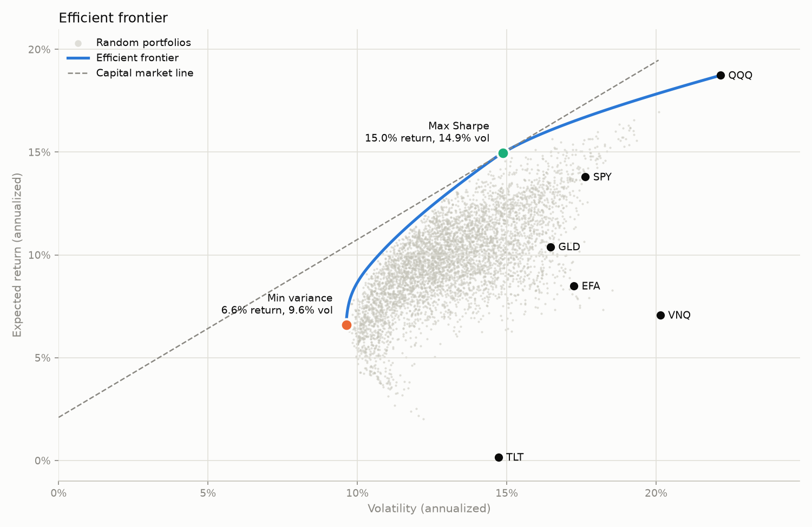
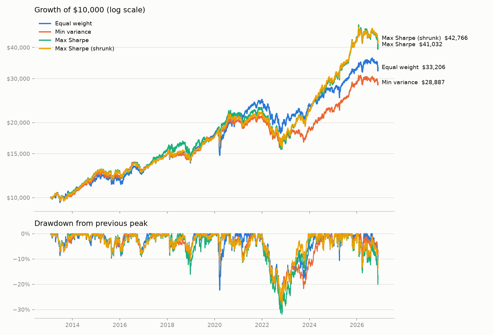

# Frontier Optimizer

I wanted to know if the "optimal" portfolio from finance textbooks works in real life. So I built a tool that decides how to split money across six ETFs, then tested it month by month on almost 14 years of market data, where it only ever got to see the past.

The textbook version doesn't hold up very well. A small change fixes most of the problem.



## The six ETFs

SPY (US stocks), QQQ (big tech), TLT (long-term government bonds), GLD (gold), VNQ (real estate) and EFA (international stocks). I picked them because they behave differently from each other, and that's the whole reason to spread money across more than one thing.

## The four strategies

**Equal weight** puts the same amount in each ETF. No thinking involved, which makes it a good benchmark.

**Min variance** looks for the smoothest ride possible. It only cares about how much things swing and never looks at returns.

**Max Sharpe** is the textbook answer. It looks for the most return per unit of risk, and it uses each ETF's past average return as its guess for the future.

**Max Sharpe (shrunk)** does the same thing, but first pulls every ETF's expected return halfway toward the group average. It's max Sharpe with less confidence in its own guesses.

## How I tested it

Every month starting in 2013, each strategy could only look at the previous three years of prices. It picked its weights, held them for a month, and I recorded how it did. Then it moved forward a month and did it again, all the way to November 2026. Each time it traded, I charged a small cost.

If you let a strategy see the whole history at once, it looks amazing, because it's studying the answers before the test. This setup stops that from happening.

## Results

The score here is the Sharpe ratio, which is how much you earned above a risk-free T-bill for each unit of risk you took. Higher is better.

| Strategy | Tested 2013 to now | Tested 2008 to now |
|---|---|---|
| Equal weight | 0.62 | 0.52 |
| Min variance | 0.66 | 0.75 |
| Max Sharpe | 0.66 | 0.65 |
| Max Sharpe (shrunk) | **0.79** | **0.79** |

When max Sharpe got to see all the data at once, it promised a score of 0.86. Tested the honest way, it scored 0.66, the same as min variance, which doesn't even try to predict returns. Past returns are a bad guess for future returns, and max Sharpe takes them at face value. That's how you end up with half the portfolio in gold because gold had a good run.

Shrinking the return guesses fixed most of that. The shrunk version scored 0.79, the best of the four, and it got the same score when I started the test in 2008 and made it get through the financial crisis.



## Adding more ETFs made things worse

I tried adding an energy ETF (XLE) and then a corporate bond ETF (LQD) to see if more options would help. Both times, every strategy did worse than with the original six.

Energy hurt max Sharpe the most, dropping it from 0.66 to 0.47. Oil went through huge booms and crashes over this stretch, and max Sharpe kept chasing whatever had just done well.

Corporate bonds hurt min variance the most, dropping it from 0.66 to 0.37. LQD barely moves, so min variance put about 70% of the money into it. It also barely earned anything (2.6% a year, when T-bills averaged about 1.8%).

So the two textbook strategies break in opposite ways. Max Sharpe trusts past returns too much and min variance doesn't look at them at all. The shrunk version handled both cases better, scoring 0.66 with energy added and 0.69 with corporate bonds.

## The worst year was 2022, not 2008

In 2008, bonds went up while stocks crashed, so holding both protected you. Min variance only lost 15% during the crisis, while equal weight lost 39%. In 2022, stocks and bonds fell at the same time. None of the strategies saw it coming, because they all learned from the previous three years, and that hadn't happened in any of them.

## What this doesn't prove

This is one set of ETFs over one stretch of history. The gaps between strategies look real, but I haven't run a statistical test on them. I picked the settings (like shrinking returns halfway) before running anything and didn't touch them after, since adjusting them until the results look good would be cheating. Taxes aren't included.

## Running it

```
python3 -m venv .venv && source .venv/bin/activate
pip install -r requirements.txt
mkdir -p results

python -m scripts.backtest_run    # run all strategies on the six ETFs
python -m scripts.compare         # compare different ETF baskets and time periods
python -m scripts.plot_growth     # growth and drawdown chart
python -m scripts.plot_frontier   # efficient frontier chart
```

To test a different ETF, add a line to `SCENARIOS` in `scripts/compare.py`.

## What's in the folder

`frontier/` holds the engine: downloading prices, estimating returns and risk, the optimizer, the month-by-month backtest and the charts. `scripts/` holds the files you run.

Built in Python with pandas, cvxpy and scikit-learn. Price data comes from Yahoo Finance.
